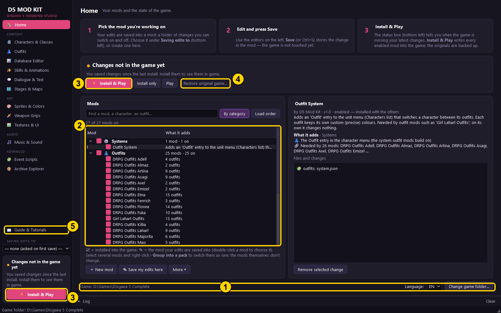

# D5 Mod Kit — Disgaea 5 Complete modding studio

D5 Mod Kit is a free, unofficial modding studio for Disgaea 5 Complete on PC that lets players change the game without touching a hex editor or a line of code. It reads the game’s own files (characters, classes, skills, items, stages, sprites, music, dialogue and scripts), shows them in a friendly interface, and saves every change into self-contained mods that install into the game with one click and come out again just as cleanly. With it you can create new recruitable characters and classes from the game’s own cast, from Disgaea RPG sprites or from any fan-made sprite sheet; give characters outfits with their own faces and colours; design new skills and edit their animations, areas and numbers in a 3D preview; build and populate battle stages in 3D, from existing maps or out of blocks; put your own music in the game with proper loops; and tweak the database behind all of it. Its purpose is to make deep, shareable Disgaea 5 modding accessible to anyone who loves the game, while keeping their saves and original files safe.

**175 outfits for 26 characters, a new playable character (Thunderlady) and an all-in-one mod editor for
Disgaea 5 Complete on PC.**

## 🚀 Quick start: get the mods into your game

Never modded a game before? Follow these steps in order. It takes about 10 minutes, and there's nothing else to
install.

**You need:** Windows 10 or 11 (64-bit), **Disgaea 5 Complete for PC** (Steam, as it is today; the October 2018
version works too), and about **4 GB** of free disk space.

### Step 1 · Back up your saves

The mods never change your saves, but a backup is always a good idea.

1. Press <kbd>Win</kbd> + <kbd>R</kbd>, paste `%APPDATA%\Nippon Ichi Software, Inc\Disgaea 5 Complete` and press
   <kbd>Enter</kbd>.
2. Copy everything in the folder that opens (your saves are inside) to somewhere safe, like your Desktop.

### Step 2 · Download the kit

Download **[D5ModKit.zip](https://github.com/eraser4521/D5ModKit/releases/latest/download/D5ModKit.zip)** (547 MB)
from the [latest release](https://github.com/eraser4521/D5ModKit/releases/latest).

> ⚠️ Don't use the green **Code › Download ZIP** button on this page: that's only the source code, without the
> mods.

### Step 3 · Put it in your game folder

1. **Close Disgaea 5** if it's running.
2. Find your game folder: in Steam, right-click **Disgaea 5 Complete** › **Manage** › **Browse local files**. It's
   the folder with `disgaea5.exe` in it.
3. Right-click the downloaded `D5ModKit.zip` › **Properties** › tick **Unblock** at the bottom (if it's there) ›
   **OK**. This stops Windows from blocking the kit's files.
4. Right-click the zip › **Extract All…** › choose your game folder › **Extract**. You now have a `D5ModKit` folder
   next to `disgaea5.exe`.

### Step 4 · Start the kit

Open the `D5ModKit` folder and double-click **`Start D5 Mod Kit.bat`**. If Windows says *"Windows protected your
PC"*, click **More info** › **Run anyway**. The kit isn't signed by a company, so Windows asks the first time.

The kit opens on its **Home** page. These are the only parts you need:

| # | What it is | What to do |
|---|---|---|
| **1** | **Game folder** | It should show your Disgaea 5 folder. If it's empty or wrong, click **Change game folder…** and pick the folder from Step 3. |
| **2** | **Mods list** | Every mod is already ticked (on). Click one to see what it adds on the right. Untick anything you don't want. |
| **3** | **⚡ Install & Play** | Puts the ticked mods into the game and starts it. Both buttons do the same thing. |
| **4** | **Restore original game…** | Takes every mod out and puts the game back exactly as it was. |
| **5** | **Guide & Tutorials** | The full illustrated guide. It's also `START HERE - Guide.html` in the kit's folder. |

### Step 5 · Install & Play

Press **⚡ Install & Play** (3). The first time takes 1 to 3 minutes: the kit backs up the original game files,
writes the mods in, then starts the game. Afterwards the box at the bottom left says 🟢 **Ready to play**.

That's it. From now on, start the game from Steam as usual. You only need the kit again to change which mods are
on.

### Step 6 · Find the mods in the game

* **Outfits:** open the main menu › **Characters** › pick a character › **Outfit** › pick a look (or **Default**).
  It changes right away. Long lists continue under **More outfits…**.
* **Thunderlady:** at the **Quest Shop**, take the quest **The Thunderlady**, complete it and report back. She
  joins your team.

### Changing things later

* **Turn a mod off:** untick it in the mods list (2) and press **⚡ Install & Play** again. Before you turn off an
  outfit mod, switch your characters back to **Default**: a save with a character wearing that outfit needs the
  mod.
* **Remove all mods:** press **Restore original game…** (4). After that you can delete the `D5ModKit` folder.
* **Several modpacks:** **Profile** (above the mods list) keeps separate sets of mods, like Mod Organizer's
  profiles for Skyrim, and can give each its own saves.
* **Updating the kit:** Home › **Check for updates** downloads only what changed (from 1.2 on).
* **Steam updated or verified the game and the mods are gone:** open the kit and press **⚡ Install & Play**
  again.

### If something goes wrong

* **Your antivirus removed files:** the mods add two small files the game loads (`d5auto.dll` and `d5core.dll`)
  and change `disgaea5.exe`. If your antivirus quarantines them, allow your game folder and the `D5ModKit`
  folder, then press **⚡ Install & Play** again.
* **The install failed:** close the game and try again. If your game is under `C:\Program Files`, right-click
  `Start D5 Mod Kit.bat` › **Run as administrator**.
* **The game says *Save needs a mod that's off!*:** your save has a character from a mod you switched off. The
  Home page names it: tick that mod again and press **⚡ Install & Play** (the game would crash in battle
  otherwise).
* **Anything else:** see *Troubleshooting & FAQ* in **Guide & Tutorials** (5), or
  [open an issue](https://github.com/eraser4521/D5ModKit/issues).

**Want to make your own mods?** Every page in the kit's left sidebar is an editor: characters and classes,
outfits, skills and their animations, dialogue, stages, sprites, music and more. **Guide & Tutorials** (5) has a
step-by-step tutorial for each one, and the rest of this page describes them all.

**Have Disgaea RPG sprites?** Outfits › **✨ New outfit** › *Disgaea RPG sprites* (or a new character / class on the
Characters & Classes page) turns a unit into a complete Disgaea 5 sprite: pick your DRPG folder, pick the unit,
done. Tutorial 5 in the guide shows the folder layout.

---

> **About this repository.** It holds the kit's code and documentation (version 1.5.8). The mods (outfits,
> Thunderlady, classes …), the Disgaea RPG reference art the outfit builder matches against
> (`d5lib/data/drpg_ref_humanoid.pickle`) and the bundled Python come with the release zip, not with this repository:
> they are drawn from Disgaea 5 / Disgaea RPG art. To run from a clone: `pip install -r requirements.txt`, then
> `python D5ModKit.pyw` (the native runtime DLLs are rebuilt from `d5lib/native` with `ziglang` on first install).

**New here? Open `START HERE - Guide.html`** (setup, every page, step-by-step tutorials, troubleshooting).

Start the kit by double-clicking **`Start D5 Mod Kit.bat`**. A shared copy of the kit carries its own Python in the
`runtime` folder (made by `tools/make_release.py`), so nothing needs to be installed. Without it, the kit uses an
installed Python 3.10+ with PyQt6, numpy, scipy, Pillow, pefile, keystone-engine and capstone
(`pip install PyQt6 numpy scipy pillow pefile keystone-engine capstone`; `ziglang` too for rebuilding the native
runtime).

The kit finds the game by itself: the folder it sits in, else Steam's libraries, else it asks (Home → Change game
folder…). It works with the Steam game as it is today (January 2019 update) and the October 2018 launch build: the
game addresses the kit uses are carried over to each build by `d5lib/exemap.py` (shipped maps in
`d5lib/data/exe_map_*.json`; a build without one is matched on the fly, and a change that can't be placed is left out
with a note). It warns about anything that would stop an install (another kit's or a package's mods still installed,
missing files) — `d5lib/gamecheck.py`. Each game folder keeps its own backups (`state/games/`).

## How it works (30-second version)
1. **Pick the mod for new edits** — bottom left, *New edits go to*. A mod is a folder of changes
   (`D5ModKit/mods/<name>/`) you can switch on and off; with none chosen, your first save asks for a name. A change
   to something a mod already makes or changes (its character, quest, skills …) is saved in that mod by itself.
2. **Edit and press 💾 Save** (or Ctrl+S). The change goes into the mod — the game is not touched yet. A file another
   of your mods already provides is saved back into that mod (the kit tells you), so no edit gets lost.
3. **Install & Play.** The status box (bottom left, also on Home) always says whether the game has your latest
   changes: 🟢 *Ready to play*, 🟠 *Changes not in the game yet*, or *Game running* (close it to install). Its one
   button does the right thing (**⚡ Install & Play** or **▶ Play**). Unsaved edits are listed before installing, so
   you can save them first. The kit backs up the original game data once (`D5ModKit/state/`).
4. **Restore original game…** (Home) puts every game file back exactly as it was; your mods stay in the kit.

Mods can be enabled/disabled, reordered (lower in the list wins conflicts), exported to `.zip` and shared.
**Profiles** (Home → Profile) keep separate modpacks, like Mod Organizer's profiles for Skyrim: each has its own
enabled mods and load order (`profiles/<id>/load_order.json`), optionally its own saves, swapped in with its mods at
install — `d5lib/profiles.py`.
The editors always show the game as your enabled mods make it (every mod's changes, the one you edit on top).

## Pages
| Page | What you can do |
|---|---|
| **Characters & Classes** | Names, stats, aptitudes, move/jump, weapon mastery, resistances, evilities, learned skills, sprite & color. **✨ New character / class** clones a template into a brand-new unit, gives it its own sprite copy, a description and a Quest-shop quest that recruits it (unique) or unlocks it (class). |
| **Outfits** | Extra outfits for unique characters, switched **in game** from the unit menu (Characters → select → **Outfit** → *Default* / outfit name; the look changes at once). **✨ New outfit** takes everything in one go: the character, the in-game name, a **sprite sheet** (frame dump with labelled rows — labels are recognised automatically; every original pose of the character gets its matching frame, so all animations, facing and motion stay the game's own), a **face picture** (status panel, Status screen, battle, character-list icon; optional mirroring) and a **cut-in portrait** (special attacks; white backgrounds are removed). The page shows a preview of everything. Installing also patches `disgaea5.exe` (backed up / restored like everything else). The first three outfits (slots 470–490) get their own small character-list icon; later ones use the character's normal icon there. |
| **Database Editor** | Every one of the 90 game tables as a spreadsheet (skills, items, evilities, stages, quests, shops, Dark Assembly…). Hover column headers for explanations, dropdowns for references, CSV export/import for Excel. |
| **Dialogue & Text** | Search all 7000 conversations, edit lines in 5 languages, change speakers, add/delete message boxes, Find & Replace across the whole game, full script view for advanced edits. |
| **Stages & Maps** | Battle map editor: move/add/delete enemies, set class, level, equipment, skills, evilities, AI, team; paint Geo Panels, place Geo Symbols, move the base panel, rename stages, clone a stage as a new level, export the 3D map to OBJ. |
| **Sprites & Colors** | Every character/monster sprite (new characters and outfits included, each opened from the mod it lives in). Palette editor with a **live animated preview** beside it: click the character to select a part, drag hue / saturation / brightness and watch the animation change; named colors (Normal / Extra Color 1-4, or tiers); palette rows = Parts of the in-game precise editor. Sprite-sheet export → repaint → import, portraits, clone as new sprite. |
| **Weapon Grips** | Where each character holds its weapon, per animation and frame. Pick a character, weapon type and animation, then **drag the weapon onto the hand** (right-drag turns it, arrow keys nudge, Q / E turn, F mirrors). Change one frame or the whole animation, show or hide the weapon, play it back. Works on new classes (every animation), outfits and the game's own characters (their idle and special poses). See [docs/WEAPON_GRIPS.md](docs/WEAPON_GRIPS.md). |
| **Skills & Animations** | What a skill looks like in battle. The **Timeline editor** plays any skill inside the kit (caster, target, effects, camera) and lets you retime, move and swap its effects, camera, motions and sounds, or add new ones from the game's effect library. You can also give a skill another skill's animation, put your own pictures into its effects, and preview edits in the running game. See [docs/SKILL_EDITOR.md](docs/SKILL_EDITOR.md) and [docs/SKILL_ANIMATIONS.md](docs/SKILL_ANIMATIONS.md). |
| **Textures & UI** | Menus, windows, icons, logos: export PNG, edit, import. Localized (English) versions are handled automatically. |
| **Music & Sound** | Play and replace all BGM tracks (intro + seamless loop) and all sound effects. MP3/WAV/FLAC are converted automatically when ffmpeg is on PATH. |
| **Event Scripts** (advanced) | All 19,053 event scripts (cutscenes, stage events, recruitment) as editable text with known command meanings, “starts / started by” links, search by any number used, and new events. |
| **Archive Explorer** | Every file inside every archive: preview, export, replace. |

## Tips & known limits
* **Keep sprite sheets the same size and layout** when repainting: sprite parts are cut from fixed rectangles
  (humanoid characters share one set of animations).
* **New ids are always above the existing maximum** (the wizard does this for you) — required so your existing
  save files keep working. Don't delete original rows.
* Brand-new stages: cloning works, but how the game unlocks and lists brand-new stages isn't fully known yet.
  To test a custom level, you can point an existing stage at your map (Database Editor → Stages → map id).
* The objective of a quest made by the wizard is copied from “Combat Lecture”; adjust it in Database Editor → Quests.
* **Capacity.** What the kit makes has no practical limit: effect models load when shown (the game alone holds
  400), ~29 700 new effect models, 7 100 custom skill animations, list icons and faces in textures that grow as
  needed (thousands), ~1 750 new sprites, 4 000 custom voices, skills / evilities / descriptions by the
  thousand; 119 new generic classes (73 humanoid, 46 monster), new Overloads by the thousand (208 with numbers of
  their own). Limits that come from the game itself: new unique characters and the outfits of unique characters
  share the ids below 1000 (714 in all), and a save keeps the progress of 1 024 quests (the game uses ~520). See
  docs/OUTFITS.md "Capacity", docs/CLASSES.md and docs/OVERLOADS.md.
* A quest's **sort_order** is its progress slot in the save: it must be unique, and Quest-shop quests (id < 2000) need a
  slot below the number of quests or the board never lists them. The wizard picks a free slot, and the installer
  moves bad ones (with a warning).
* **New unique characters get a class id below 1000** (the unused “DLC Dummy” rows 970/980/990, then 971–999):
  the game treats every class id ≥ 1000 as a generic class (colour lists, tiers ...), which broke e.g. the
  Strategy Assembly's extra colours.
* The precise colour editor edits a sprite's palette in rows of 16 colours (rows 1–15). Outfit sprites made by
  the kit put every part (hair, clothes, skin ...) in a row of its own, like the game's sprites, and each outfit
  keeps its own custom colours when you switch outfits. To decide the parts yourself: Outfits → *Export parts to
  paint*, paint them (e.g. Paint.NET), *Import painted parts* ([docs/COLORS.md](docs/COLORS.md)).
* **Evilities, skills and Overloads work on any character you edit or add** — no story locks. The game holds the
  main cast's second evilities, most Overloads and some unique skills back until a story flag is set, gives a unit
  one unique-evility slot, and reads only the first `evility_count` innate evilities (char.dat +0xC8, which the kit
  now sets for you). For every character row a mod changes, the installer patches all of that away
  (`d5lib/unlockpatch.py`); already recruited units get the new evilities / slots / skills the next time the game
  refreshes them (opening a menu, changing equipment ...). Characters no mod touches keep the story's order.
* **Disgaea RPG outfits for 25 characters** (167 outfits: Killia, Seraphina, Majorita, Asagi, Laharl, Etna, Flonne,
  Sicily, Girl Laharl, Pleinair, Valvatorez, Fenrich, Artina, Fuka, Emizel, Nisa, Mao, Salvatore, Almaz, Sapphire,
  Adell, Rozalin, Axel, Pram, Petta), one mod per character (`DRPG_Outfits_<Name>`), made from `DRPG Assets` by
  `python tools/drpg_outfits.py learn` / `build` (catalog `d5lib/data/drpg_outfit_catalog.json`; add units there).
  See docs/OUTFITS.md "DRPG outfits for every character".
* **Disgaea RPG sprites in the editor** (`d5lib/drpgsource.py`, `d5gui/drpgpicker.py`): Outfits › New outfit and
  Characters & Classes › New character / class › Look: *Disgaea RPG sprites* open a unit browser (your DRPG folder,
  names from `Units IDs.txt`, a checklist of the four sheets each unit has, *Use my own sheet files…* for sheets from
  anywhere) and build the outfit, character or class in the background. Guide: Tutorial 5.
* **Character studio** (Characters & Classes, [docs/CHARACTER_STUDIO.md](docs/CHARACTER_STUDIO.md)): a new
  character can wear any outfit's look (a Disgaea RPG outfit is drawn again as a complete character; the outfit can
  be hidden from the Outfit menu by the new mod without editing the outfit's mod), start from stat presets or copy
  parts of any character, get a skill of its own (the skill editor opens on it, with a way back) and evilities of
  its own (named by you, working like a game evility). One character = one mod.
* **Overloads of your own** (Skills & Animations → ⚡ New Overload…, [docs/OVERLOADS.md](docs/OVERLOADS.md)): any
  character (game or new) can get a new Overload — the code of a game Overload or numbers of its own (power,
  element, area, effects), its own animation, name banner and description — and the game's Overloads can be changed.
* **Mods on the Home page** are grouped by category with readable contents ("4 outfits for Killia: …"), search,
  packs (several mods switched as one, without changing them) and a load order view (`d5lib/modinfo.py`).
* **Sharing between kit users** ([docs/SHARING.md](docs/SHARING.md)): a shared mod carries an identity and a
  version; importing a later one updates it, ids that clash with your mods are moved and remembered (saves stay
  valid), *Make my own version* builds on someone's mod without changing it.
* **Sharing with players**: `python tools/export_pack.py Pack.exe --title "..."` makes one installer .exe that
  installs your mods into anyone's game in seconds and uninstalls them byte-exact (no Python needed). See
  [docs/SHARING.md](docs/SHARING.md). Installing everything in the kit takes about a minute.
* Mods are kept separate: **Outfit System** (the feature) / **Girl Laharl Outfits** (content, requires the system) /
  **Thunderlady** (a new character: Girl Laharl's lightning alternative, with the Thunderlady outfits). A mod lists what it needs in `mod.json`
  (`"requires"`); the Home page and the installer warn when a required mod is off.
* Recruit quests (reward “character joins”) only move a unit the story left in the hidden reserve. For new
  characters the installer adds a small exe hook that creates the unit (level 1) when the quest is completed.
* Untested in-game so far: sprites larger than the original, more color variants than the original,
  and new generic class ids above 10000 (the game special-cases class ids 1000–1310 / 2010–2300 for portrait colors).
  Test these on a spare save.

## For tinkerers
* `d5lib/` — Python library for every format (NISPACK archives, LZS/YKCMP compression, TXF textures, anm sprites,
  maps, 3D `.obf`, database tables, talk.dat dialogue, script.dat, sound archives) plus the mod/installer system.
* `docs/` — format documentation: `FORMATS.md`, `ANM.md`, `DATABASE.md`, `MAPS_AND_OBJECTS.md`, `EXE_ANALYSIS.md`.
* `_extracted/` (~9.5 GB) is only a research cache made by `extract_all.py`; the app does not need it —
  delete it to free space.
* **Sharing the whole kit:** `python tools/make_release.py OUT_DIR --zip` makes `OUT_DIR/D5ModKit` (+ `.zip`): the
  kit, the mods of a release profile (default `outfits`: the Outfit System and the outfit mods; `--profile all` /
  `--mods A,B`), a private Python 3.10 with the libraries (`runtime/`, `python310._pth` keeps it isolated from any
  installed Python), the compiled runtime DLLs (`cache/`), the guide and launchers (`Start D5 Mod Kit.bat`,
  `D5 Mod Kit Console.bat`).  Left out: `state/` (this PC's backups), the rest of `cache/`, `_research/`,
  `_extracted/`, the underscore test tools, `settings.json`, and the Disgaea RPG asset folders (the mods are already
  built from them; the guide says where the other player puts their own copy for the DRPG builders; `--drpg` adds
  the sprites / faces / cut-ins the builders read, ~1 GB).  Tested
  2026-10-10: a staged copy, on its own Python, installs byte-identical game files to this kit's install and its
  restore returns the original files exactly.

* [Original RPG costume idle timing](docs/RPG_IDLE_TIMING.md): export local source
  clocks, rebuild existing costume idles, and use those clocks in future builds.

### macOS editor

See [macOS setup](docs/MACOS.md) for the native editor, host LZS codec, Finder launcher, and Steam/Wine game routing.
